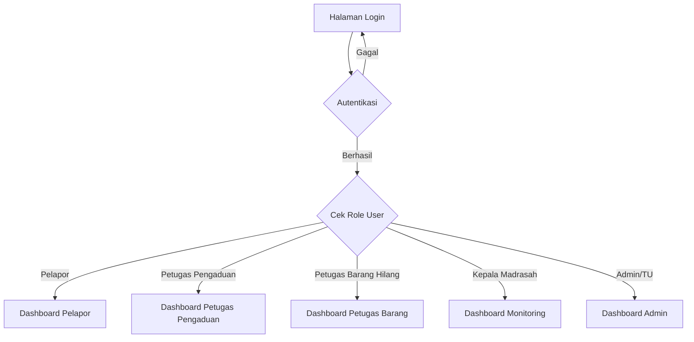
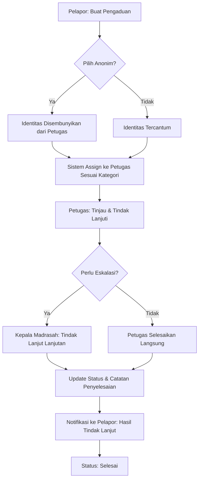
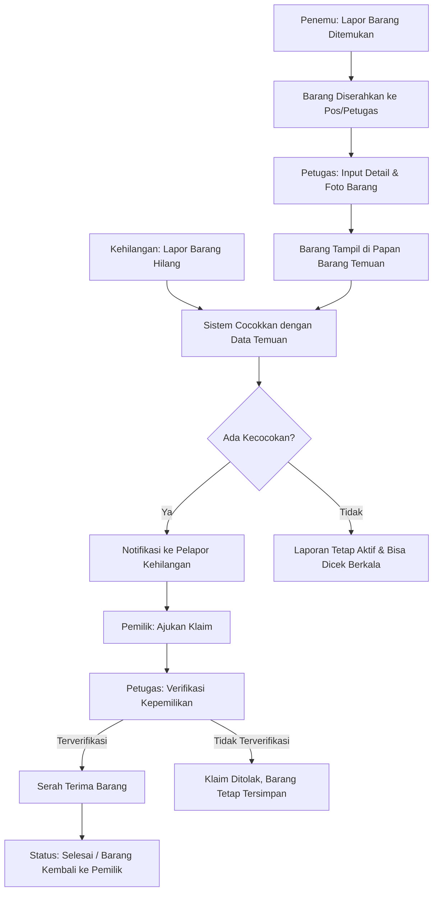
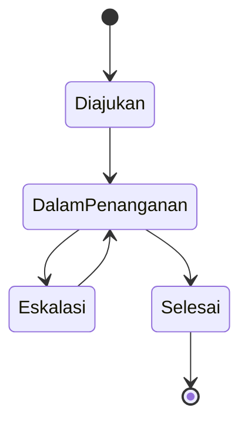
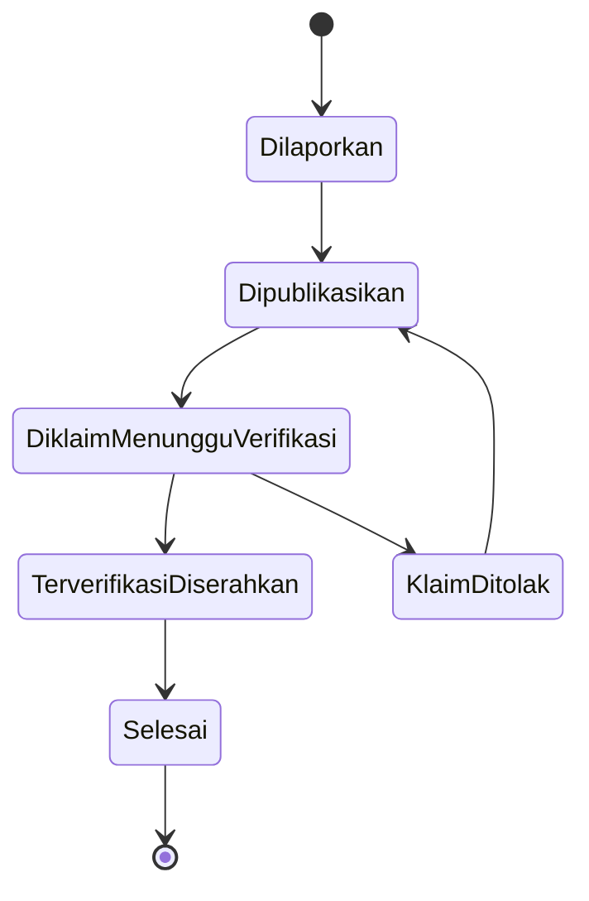

# Workflow Aplikasi Pengaduan & Barang Hilang Madrasah

### Kritik/Saran, Laporan Penemuan Barang, dan Pencarian Barang Hilang

Dokumen ini adalah rancangan alur kerja (workflow) aplikasi bagi siswa dan civitas akademika madrasah untuk menyampaikan pengaduan (kritik & saran), melaporkan barang yang ditemukan, maupun mencari barang yang hilang.

---

## 1. Daftar Role Pengguna

| No | Role | Deskripsi Singkat |
| --- | --- | --- |
| 1 | **Pelapor** (Siswa/Guru/Karyawan/Orang Tua) | Mengajukan pengaduan, melaporkan barang ditemukan, atau melaporkan barang hilang |
| 2 | **Petugas Penanganan Pengaduan** (Kesiswaan/BK) | Menindaklanjuti pengaduan sesuai kategori |
| 3 | **Petugas Barang Hilang/Temuan** (TU/Satpam) | Mengelola barang temuan fisik, verifikasi klaim, serah terima barang |
| 4 | **Kepala Madrasah/Pimpinan** | Menerima eskalasi kasus serius & memantau laporan keseluruhan |
| 5 | **Admin/TU** | Mengelola kategori, akun pengguna, dan pengaturan sistem |

> Semua civitas akademika (siswa, guru, karyawan, orang tua) berperan sebagai **Pelapor** dengan hak akses yang sama, dibedakan hanya dari data identitas pelapor.

---

## 2. Alur Login & Pengalihan Halaman

**Ketentuan login:**

- Pengaduan dapat diajukan dengan opsi **anonim** — identitas pelapor tetap tercatat di sistem untuk keperluan tindak lanjut, namun disembunyikan dari tampilan petugas jika pelapor memilih anonim (kecuali untuk kasus yang memerlukan investigasi lebih lanjut).
- Laporan barang hilang/ditemukan wajib menggunakan identitas asli (tidak bisa anonim), karena menyangkut proses verifikasi kepemilikan & serah terima fisik.
- Orang tua dapat login menggunakan akun terhubung ke data anak (opsional), atau akun mandiri sebagai bagian dari civitas akademika.

---

## 3. Struktur Menu per Role

### 3.1 Pelapor (Siswa/Guru/Karyawan/Orang Tua)

| Menu | Fungsi |
| --- | --- |
| Dashboard | Ringkasan status semua laporan yang pernah diajukan |
| Buat Pengaduan | Form kritik/saran/pengaduan, dengan opsi anonim & pilihan kategori |
| Lapor Barang Ditemukan | Form laporan temuan barang: foto, deskripsi, lokasi & waktu ditemukan |
| Lapor Barang Hilang | Form laporan kehilangan: foto (jika ada referensi), deskripsi detail, lokasi & waktu terakhir terlihat |
| Papan Barang Temuan | Daftar barang temuan yang belum diklaim, bisa dicari/difilter |
| Status Laporan Saya | Melihat status tindak lanjut tiap laporan (pengaduan/temuan/kehilangan) |
| Riwayat Laporan | Semua laporan yang pernah diajukan beserta hasil akhirnya |

### 3.2 Petugas Penanganan Pengaduan

| Menu | Fungsi |
| --- | --- |
| Dashboard | Daftar pengaduan masuk sesuai kategori yang ditangani |
| Detail Pengaduan | Lihat isi pengaduan, tindak lanjuti, ubah status, tambah catatan |
| Eskalasi | Teruskan kasus ke Kepala Madrasah jika dianggap serius/sensitif |
| Riwayat Penanganan | Rekap seluruh pengaduan yang sudah ditangani |

### 3.3 Petugas Barang Hilang/Temuan

| Menu | Fungsi |
| --- | --- |
| Dashboard | Daftar barang temuan aktif & laporan kehilangan yang belum ketemu |
| Verifikasi Klaim | Cocokkan klaim pemilik dengan detail barang temuan (pertanyaan verifikasi kepemilikan) |
| Serah Terima Barang | Catat proses penyerahan barang ke pemilik sah, dengan tanda tangan/foto bukti |
| Manajemen Papan Temuan | Kelola tampilan barang temuan yang dipublikasikan/di-takedown |
| Riwayat Transaksi | Rekap seluruh barang yang sudah diserahkan maupun yang masih tersimpan |

### 3.4 Kepala Madrasah/Pimpinan

| Menu | Fungsi |
| --- | --- |
| Dashboard Monitoring | Statistik pengaduan & barang hilang/temuan secara keseluruhan |
| Pengaduan Eskalasi | Kasus serius yang memerlukan keputusan/tindak lanjut pimpinan |
| Laporan Ringkas | Unduh laporan periodik untuk evaluasi |

### 3.5 Admin/TU

| Menu | Fungsi |
| --- | --- |
| Manajemen Kategori Pengaduan | Atur kategori (akademik, fasilitas, pelayanan, perilaku, dll.) & petugas penanggung jawab tiap kategori |
| Manajemen Lokasi/Pos Barang | Atur titik pengumpulan barang temuan fisik |
| Manajemen Akun & Role | Tambah/edit/nonaktifkan akun pengguna |
| Pengaturan Sistem | Batas waktu tindak lanjut pengaduan, notifikasi, dll. |

---

## 4. Alur Pengaduan (Kritik & Saran)

---

## 5. Alur Lapor & Klaim Barang (Ditemukan/Hilang)

---

## 6. State Diagram Status Pengaduan

## 7. State Diagram Status Barang

---

## 8. Pertimbangan Keamanan & Validasi

- **Opsi anonim untuk pengaduan sensitif**: identitas pelapor tetap tersimpan di database (untuk audit/legal), tapi disembunyikan dari tampilan petugas kecuali kasus memerlukan investigasi resmi.
- **Verifikasi kepemilikan barang** sebelum serah terima: petugas wajib menanyakan detail spesifik barang (ciri khusus, isi, dll.) yang hanya diketahui pemilik asli, guna mencegah klaim palsu.
- **Foto/bukti serah terima**: setiap penyerahan barang dicatat dengan foto & tanda tangan digital sebagai bukti transaksi.
- **Audit trail lengkap**: setiap perubahan status pengaduan maupun barang tercatat siapa yang mengubah dan kapan.
- **Role-Based Access Control (RBAC)**: petugas pengaduan hanya menangani kategori yang menjadi tanggung jawabnya; petugas barang hanya mengelola modul barang.
- **Batas waktu tindak lanjut (SLA)**: sistem memberi peringatan otomatis ke petugas/pimpinan jika pengaduan belum ditindaklanjuti melewati batas waktu yang ditentukan.
- **Moderasi konten**: filter otomatis atau tinjauan petugas untuk mencegah penyalahgunaan fitur pengaduan (misal konten fitnah atau tidak relevan).

---

## 9. Usulan Fitur Tambahan (Ide)

- **Matching otomatis barang hilang–ditemukan** berbasis kata kunci/kategori/lokasi, dengan notifikasi otomatis ke pelapor kehilangan saat ada kecocokan.
- **Rating kepuasan penyelesaian pengaduan**: pelapor bisa menilai apakah tindak lanjut memuaskan, sebagai bahan evaluasi petugas.
- **Statistik tren pengaduan per kategori/periode**: membantu pimpinan melihat area yang paling sering dikeluhkan untuk perbaikan sistemik.
- **QR code tanda terima barang**: dicetak/dikirim digital sebagai bukti resmi saat barang diserahkan kembali ke pemilik.
- **Notifikasi berkala barang belum diklaim**: mengingatkan petugas untuk barang yang sudah lama tersimpan (misal 30 hari) agar diproses lebih lanjut (lelang/sumbangan sesuai kebijakan madrasah).
- **Chat/tanya-jawab dalam laporan**: petugas dan pelapor bisa berdiskusi langsung dalam satu thread laporan tanpa perlu kontak terpisah.
- **Kategori prioritas pengaduan**: mis. keamanan/kekerasan ditandai prioritas tinggi dan otomatis notifikasi ke pimpinan sejak awal.
- **Dashboard publik ringkas** (opsional): menampilkan statistik non-sensitif (jumlah pengaduan selesai, waktu rata-rata tindak lanjut) untuk transparansi kepada civitas akademika.

---

## 10. Ringkasan Halaman Aplikasi (Page List)

1. Halaman Login
2. Dashboard (berbeda tampilan per role)
3. Form Buat Pengaduan (dengan opsi anonim)
4. Form Lapor Barang Ditemukan
5. Form Lapor Barang Hilang
6. Papan Barang Temuan (publik untuk civitas akademika)
7. Halaman Detail & Tindak Lanjut Pengaduan (Petugas)
8. Halaman Verifikasi Klaim & Serah Terima Barang (Petugas)
9. Halaman Eskalasi Kasus (Petugas → Pimpinan)
10. Manajemen Kategori & Lokasi (Admin)
11. Manajemen Akun & Role (Admin)
12. Laporan & Statistik (Petugas, Pimpinan)
13. Status & Riwayat Laporan Saya (Pelapor)
14. Halaman Profil (semua role)

---

*Dokumen ini bisa menjadi acuan awal untuk desain database (tabel: users, pengaduan, kategori_pengaduan, barang_temuan, laporan_kehilangan, klaim, serah_terima, log_tindak_lanjut) dan wireframe UI aplikasi.*